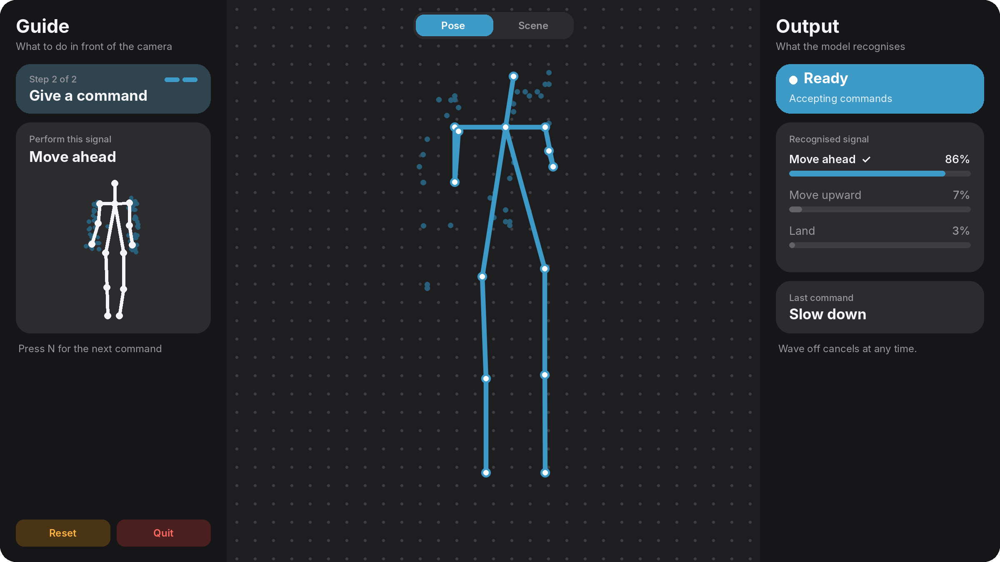
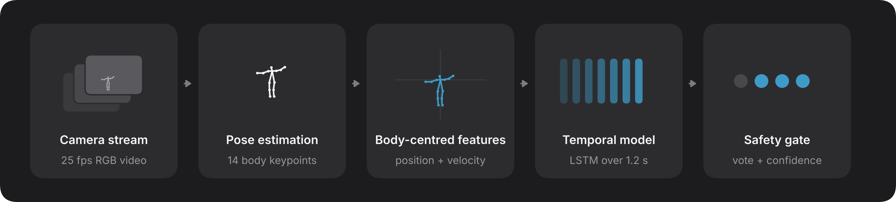

# UAV Body Signals

Recognise the body signals of a person on the ground from a drone's camera, and turn them into commands the drone can act on safely.



[](#citation)
[](LICENSE)
[](#getting-started)

## Overview

In search and rescue, a responder may need a drone to hover, change altitude, land or abort when no radio or controller is at hand. Ground crews already direct aircraft with a set of standard body signals. This project recognises 13 of them from the drone's own camera.

The recogniser works on 14 body keypoints rather than images, so it runs with any 2D pose estimator, at any frame rate, in about 2 ms per decision on a CPU. A safety gate sits between recognition and the drone, and acts only after the person asks for attention and the signal holds steady.

## How it works



1. **Pose estimation.** A pose estimator finds 14 body joints in each frame. Any estimator works.
2. **Features.** Every 0.2 s, the last 1.2 s of keypoints is centred on the neck and scaled by torso length, so position in the frame and distance to the camera no longer matter. Joint velocities are added.
3. **Classifier.** A two-layer LSTM with 229k parameters reads the window and gives a probability for each of the 13 signals.
4. **Safety gate.** A signal is accepted when it wins 6 of the last 8 windows with a mean confidence of at least 0.7. *Have command* arms the gate and the next accepted signal is executed. *Wave off* aborts at any time without arming, but it still has to pass the same vote.

During training, each window is also shown as a drone might have seen it, tilted, rolled, with missing joints or at a lower frame rate. This is what keeps recognition working as the camera looks down. Nothing is changed at test time.

## Getting started

You need Python 3.9 or later. No GPU is required.

```bash
git clone https://github.com/iamabdirazak/uav-body-signals.git
cd uav-body-signals
pip install -r requirements.txt
python -m pytest tests
```

The tests need no data and finish in seconds.

## Use it in your own system

`Recogniser` is the single entry point. Feed it one frame of keypoints at a time with its timestamp. It resamples to 25 Hz, classifies every 0.2 s, applies the safety gate and returns a command when one is accepted.

```python
from uavsignals import Recogniser

recogniser = Recogniser.from_pretrained()

for t, keypoints, visible in pose_stream():        # seconds, (14, 2) pixels, (14,) bool
    out = recogniser.push(t, keypoints, visible)
    if out and out.command:
        send_to_flight_controller(out.command)     # e.g. 'hover', 'land', 'wave_off'
```

Each result also carries the class probabilities (`out.probs`), the most likely signal (`out.signal`) and whether the gate is armed (`out.armed`).

| Input | Details |
|:--|:--|
| **Keypoints** | 14 joints in COCO body order without eyes and ears. Nose and neck, then right shoulder, elbow and wrist, left shoulder, elbow and wrist, right hip, knee and ankle, and left hip, knee and ankle. Without a neck joint, use the midpoint of the shoulders. |
| **Frame rate** | Any. The pose estimator sets the pace, and recognition holds down to about 3 fps. Run `python demo/benchmark.py` to time the full pipeline on your device. |
| **Gate** | Pass `k`, `n` and `tau` to `from_pretrained` to make the gate stricter or more responsive. |
| **Signals** | *all clear, have command, hover, land, landing direction, move ahead, move downward, move to left, move to right, move upward, not clear, slow down, wave off* |
| **Retraining** | For another pose estimator or new signals, retrain with [`training.py`](uavsignals/training.py). The released model was trained on every video of UAV-GESTURE. |

## Live demo

The demo runs the whole pipeline on a webcam or a video file, with MediaPipe as the pose estimator.

```bash
pip install -r demo/requirements.txt
python demo/run.py                    # or --camera 1, or --video clip.mp4
```

Stand 2 to 4 m from the camera with your whole body in view. Perform *have command* until Output shows **Ready**, then perform the signal shown in Guide. Press N or P to change signal, V to switch view, R to reset and Q to quit.

The model was trained on drone footage, and the demo uses a ground-level camera with a different pose estimator, so treat it as a demonstration rather than a measure of accuracy.

## Performance

Measured offline on recorded aerial video, on people the model never saw in training, as the mean of five training runs.

| Measure | Result |
|:--|--:|
| Accuracy on unseen people ([UAV-GESTURE](https://asankagp.github.io/uavgesture)) | 90.5% |
| Accuracy with the camera tilted 70° down (simulated) | 85.4% |
| Accuracy on another dataset without retraining ([UAV-Human](https://sutdcv.github.io/uav-human-web/)) | 55.1% |
| Wrong actions per command stream, without and with the gate | 4.60 → 0.05 |
| Recogniser time per decision, laptop CPU | 2.1 ms |

The model has not been flight-tested. It is least reliable when the signalling arms point toward a steeply angled camera, and on footage from a camera and pose estimator it was not trained with. It has no class for unrelated movement, so the gate is what keeps everyday motion from becoming commands. The paper covers where the model holds and where it breaks in detail.

## Reproducing the results

Download the UAV-GESTURE keypoints and splits (16 MB, the videos are not needed).

```bash
bash scripts/get_data.sh
```

The cross-dataset test also needs the skeleton data of [UAV-Human](https://sutdcv.github.io/uav-human-web/). It is available for non-commercial research and cannot be redistributed, so download `Skeleton.zip` from its website and convert it once.

```bash
python scripts/prepare_uavhuman.py ~/Downloads/Skeleton.zip data/uavhuman_skeletons.npz
```

Then run every experiment in order with `bash scripts/run_all.sh`, or one at a time.

| Experiment | Command | Time |
|:--|:--|:--|
| Train and test every model, five seeds | `python -m experiments.train` | ~3 h |
| Train and test the released model only | `python -m experiments.train lstm` | ~25 min |
| Non-temporal baselines | `python -m experiments.baselines` | ~20 min |
| Sensor and viewpoint conditions | `python -m experiments.robustness` | ~5 min |
| Camera models unseen in training | `python -m experiments.viewpoint` | ~5 min |
| Safety gate on command streams | `python -m experiments.safety_gate` | ~5 min |
| UAV-Human | `python -m experiments.uavhuman` | ~5 min |
| Dataset statistics, model size and speed | `python -m experiments.dataset_stats && python -m experiments.benchmark` | seconds |
| Summary | `python -m experiments.summary` | seconds |

<sub>Times are for a 2-core CPU. Every experiment after training uses the checkpoints that training writes.</sub>

Every model is tested on actors held out from training, in three folds defined in [`protocol.py`](uavsignals/protocol.py). Outputs go to `runs/`, and training can be stopped and restarted. The outputs behind the paper are in [`results/runs`](results/runs), summarised in [`results/paper.json`](results/paper.json). Training is seeded, but numbers can still shift slightly with the PyTorch version and the processor.

<details>
<summary><b>Repository layout</b></summary>

<br>

| Path | Contents |
|:--|:--|
| `uavsignals/` | The library: [`features`](uavsignals/features.py), [`augment`](uavsignals/augment.py), [`models`](uavsignals/models.py), [`gate`](uavsignals/gate.py), [`recogniser`](uavsignals/recogniser.py), plus data loading, folds and training |
| `experiments/` | One script per experiment, and the summary |
| `demo/` | Live demo: camera, pose estimation and the window |
| `weights/` | The released model |
| `results/` | Experiment outputs and their summary |
| `scripts/` | Data download and preparation, and a script that runs every experiment |
| `tests/` | Fast checks that need no data |

</details>

## Citation

This repository accompanies the paper *Toward Viewpoint-Robust Body-Signal Recognition for Commanding UAVs in Search and Rescue*, presented at IEEE USYS 2026. The link will be added once the proceedings are published.

```bibtex
@inproceedings{muhumed2026viewpoint,
  title     = {Toward Viewpoint-Robust Body-Signal Recognition for Commanding {UAVs} in Search and Rescue},
  author    = {Muhumed, Abdirisak Mubarik and Sariff, Nohaidda and Saruchi, Sarah 'Atifah and Mohd Tahir, Noor Idayu},
  booktitle = {IEEE International Conference on Underwater System Technology: Theory and Applications (USYS)},
  year      = {2026}
}
```

## Acknowledgements

We thank A. G. Perera, Y. W. Law and J. Chahl for releasing UAV-GESTURE and its keypoints, from which the demo's reference poses are also derived, and the authors of UAV-Human for making their dataset available for research.

The code is released under the [MIT License](LICENSE). UAV-GESTURE and UAV-Human have their own terms, set by their authors.
