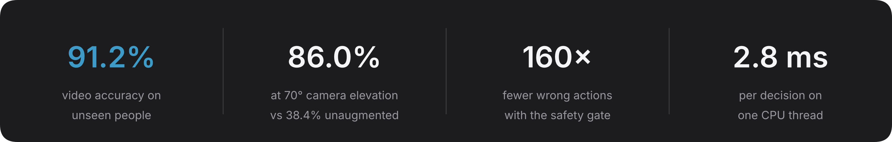
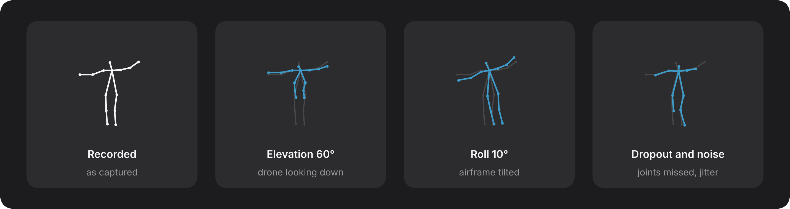
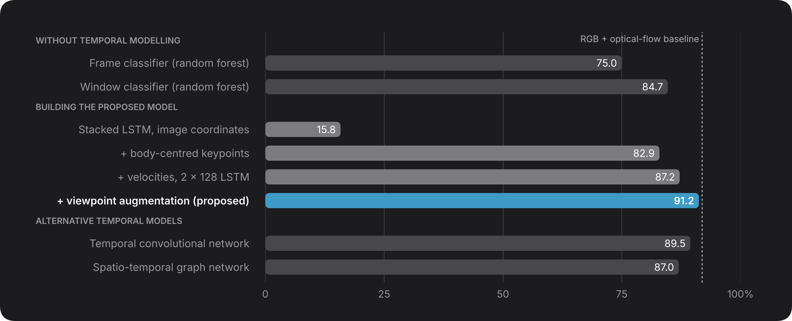
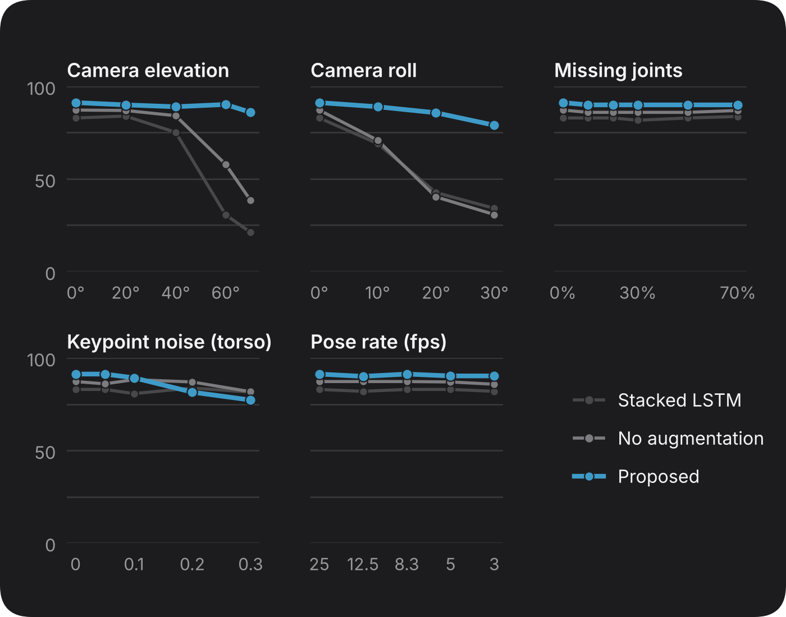
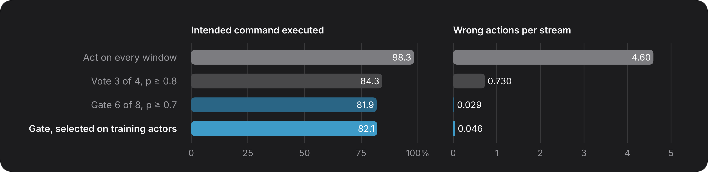

# Body-Signal Recognition for Commanding Drones in Search and Rescue

In search and rescue, a responder on the ground may need to direct a drone without a radio or controller. This system lets them use the body signals ground crews already use to guide aircraft, recognised through the drone's own camera. It keeps working when the drone looks down at steep angles, and acts only when it is sure.

[](#citation)
[](LICENSE)


<sub>The live demo: the signal to perform, the tracked body, and what the model recognises.</sub>

<br>



<sub>Offline evaluation on recorded aerial video, tested on people the model never saw in training.</sub>

## Overview

During a rescue, a responder may need a drone to hold position over a casualty, change altitude, land or abort, often with their hands busy, gloves on, or no controller within reach. Aviation already has a vocabulary for this: the standardised aircraft-handling signals that ground crews use to direct aircraft. This project teaches a drone to read those signals from its own camera.

Reading them from the air is harder than reading them from the ground, for three reasons:

- **The camera moves.** The person drifts around the frame and is seen from changing heights and distances.
- **The viewpoint is oblique.** A drone looks down at the body, which foreshortens it and changes the shape of every signal.
- **A wrong command is worse than a late one.** For an aircraft near people, acting on a misread signal is the failure that matters.

The approach is deliberately small. Each person is reduced to 14 body keypoints and described relative to their own body. A compact recurrent network classifies 1.2 seconds of movement, trained on simulated drone viewpoints. A safety gate then turns recognised signals into commands only when the evidence is consistent. The result runs on a single CPU core alongside any pose estimator, and it is the implementation behind the paper *Toward Viewpoint-Robust Body-Signal Recognition for Commanding UAVs in Search and Rescue* (IEEE USYS 2026).

## How it works


Every video frame passes through five stages, from camera image to a command the drone can act on.

| Stage | What it does |
|:--|:--|
| **Pose estimation** | A 2D pose estimator finds 14 body joints in each frame. Any estimator works. The paper uses the OpenPose keypoints released with the dataset, and the demo uses MediaPipe. |
| **Body-centred features** | Each 1.2 s window is centred on the neck and scaled by torso length, so where the person stands in the frame, and how far away, no longer matters. Missing joints are interpolated over time and velocities are added, giving 56 values per frame. |
| **Temporal model** | A two-layer LSTM with 128 units classifies the window into one of 13 signals. It reads time in one direction only, so on board it can update frame by frame. |
| **Safety gate** | Every 0.2 s, the gate accepts a signal only if it wins 6 of the last 8 windows with mean confidence of at least 0.7. *Have command* arms the gate, the next accepted signal is executed, and *wave off* always goes through so an abort is never delayed. |

The model learns to handle the drone's viewpoint through augmentation. During training, every window is shown as a drone might see it, and nothing is changed at test time.



<sub>One recorded pose and three of the perturbations applied in training. Training also varies scale, hides one arm for up to 30 frames, and lowers the pose rate to as little as 5 fps.</sub>

The 13 signals are those in the [UAV-GESTURE](https://asankagp.github.io/uavgesture) dataset, taken from the NATOPS aircraft-handling manual: *all clear, have command, hover, land, landing direction, move ahead, move downward, move to left, move to right, move upward, not clear, slow down* and *wave off*.

## Results

All results are on people the model never saw in training. Each of three folds holds out a different group of actors (see [Evaluation protocol](#evaluation-protocol)).

**Recognition.** Describing keypoints relative to the body is what makes the task learnable from a moving camera: the same network goes from 15.8% to 82.9%. Velocities and augmentation then bring a keypoint-only model to 91.2%, level with a baseline that also uses colour images and optical flow.



<sub>Video accuracy, mean of three folds. The dashed line is the RGB and optical-flow baseline reported with the dataset.</sub>

**Robustness.** Viewpoint is the main way recognition fails. As the simulated camera tilts down to 70°, models trained without augmentation fall to between 21% and 38%, while the proposed model holds at 86%. Missing joints and low pose rates barely matter. Heavy keypoint noise is the remaining weakness.



<sub>Video accuracy as each condition is applied to test keypoints, without retraining. Training covered elevation up to 60°, roll up to 10°, dropout up to 30% and noise up to 0.08 torso lengths.</sub>

**Safety.** Acting on every prediction executes the intended command almost every time, but adds nearly five wrong actions per stream. The gate cuts wrong actions to 0.03, about 160 times fewer, at the cost of 1 s of extra latency and some missed commands.



<sub>168 command streams from unseen actors. k/n is the number of windows that must agree out of the last n, and p is the confidence threshold. The settings were chosen with the test streams in view, so read them as a trade-off rather than a tuned optimum.</sub>

## Limitations

These results describe a method evaluated offline, not a system proven in flight.

- **Offline evaluation.** All experiments use recorded video. There was no flight test, and closed-loop latency was not measured.
- **Simulated viewpoint.** The dataset was filmed at low altitude, so elevation, roll and keypoint degradation were simulated on keypoints with a first-order model that ignores depth.
- **Conditions not tested.** Lighting, weather, smoke, rotor downwash, long range and thermal imagery all act on the pose estimator, and none were evaluated.
- **No "other movement" class.** The model always outputs one of the 13 signals. The attention signal is the only guard against everyday motion being read as a command, and there is no way yet to pick out an authorised signaller among several people.
- **Hand shape is not used.** Signals that differ mainly in the hands are confused. *Not clear* is mistaken for *all clear* in 4 of 9 videos.
- **Small dataset.** UAV-GESTURE has 11 actor IDs from 8 people at one site, and each result comes from one training run per fold.
- **Intended users.** The signals are meant for trained responders. People in distress use different ground-to-air conventions.

---

## Getting started

You need Python 3.9 or later. No GPU is required: every experiment was run on an ordinary CPU.

```bash
git clone https://github.com/iamabdirazak/uav-body-signals.git
cd uav-body-signals
pip install -r requirements.txt
python -m pytest tests
```

The tests need no data and finish in seconds. To run the experiments, also download the UAV-GESTURE keypoints and splits (16 MB; the videos are not needed):

```bash
bash scripts/get_data.sh
```

<details>
<summary><b>Repository layout</b></summary>

<br>

| Path | Contents |
|:--|:--|
| `uavsignals/` | The library: [`features`](uavsignals/features.py), [`augment`](uavsignals/augment.py), [`models`](uavsignals/models.py), [`gate`](uavsignals/gate.py), [`recogniser`](uavsignals/recogniser.py), plus data loading, folds and training |
| `experiments/` | One script per result in the paper, and the figure generator |
| `demo/` | Live webcam demo: camera, pose estimation and the window |
| `weights/` | The released model, trained on all actors |
| `results/` | Every number in the paper, and a re-run on another machine |
| `scripts/` | Data download |
| `tests/` | Fast checks that need no dataset |

</details>

## Live demo

The demo runs the full pipeline on a webcam or a video file.

```bash
pip install -r demo/requirements.txt
python demo/run.py                    # or --camera 1, or --video clip.mp4
```

Stand 2 to 4 m from the camera with your whole body in view. Perform *have command* until Output shows **Ready**, then perform the signal shown in Guide.

| Key | Action |
|:--|:--|
| N / P | Next or previous signal |
| V | Switch between pose and camera view |
| R | Reset |
| Q | Quit |

The model was trained on OpenPose keypoints seen from a drone, while the demo uses MediaPipe on a ground-level camera. Treat it as a demonstration rather than an evaluation.

## Use it in your own system

`Recogniser` is the single entry point. Feed it one frame of keypoints at a time, from any pose estimator at any frame rate. It resamples to 25 Hz, classifies every 0.2 s, applies the safety gate and returns a command when one is accepted.

```python
from uavsignals import Recogniser

recogniser = Recogniser.from_pretrained()

for t, keypoints, visible in pose_stream():        # seconds, (14, 2) pixels, (14,) bool
    out = recogniser.push(t, keypoints, visible)
    if out and out.command:
        send_to_flight_controller(out.command)     # e.g. 'hover', 'land', 'wave_off'
```

Each result also carries the class probabilities (`out.probs`), the most likely signal (`out.signal`) and the gate's state (`out.armed`).

- **Keypoints.** Supply 14 joints in COCO body order without eyes and ears: nose and neck; right shoulder, elbow and wrist; left shoulder, elbow and wrist; right hip, knee and ankle; left hip, knee and ankle. If your estimator has no neck joint, use the midpoint of the shoulders.
- **Frame rate.** The pose estimator sets the frame rate, not the classifier, which needs about 3 ms per decision. Accuracy holds down to 3 fps. Run `python -m experiments.benchmark` to measure your device.
- **Gate settings.** Pass `k`, `n` and `tau` to `from_pretrained` to make the gate stricter or more responsive.
- **Retraining.** For a different pose estimator or new signals, retrain with [`training.py`](uavsignals/training.py). The released model was trained on all 119 videos, so its own accuracy can't be measured on this dataset; the fold results describe the method.

## Reproduce the paper

Each result in the paper has one command. Scripts write their numbers to `runs/results/` and their checkpoints to `runs/checkpoints/`.

| Result | Command | Time |
|:--|:--|:--|
| Recognition, all models | `python -m experiments.train` | ~45 min |
| Recognition, proposed model only | `python -m experiments.train lstm` | ~7 min |
| Non-temporal baselines | `python -m experiments.baselines` | ~4 min |
| Robustness | `python -m experiments.robustness` | ~1 min |
| Safety gate | `python -m experiments.safety_gate` | seconds |
| Model size and speed | `python -m experiments.benchmark` | seconds |
| Figures from your runs | `python -m experiments.figures --from-runs` | seconds |

<sub>Times are for a 2-core CPU. Robustness and the safety gate use the checkpoints written by training.</sub>

Training is seeded, but results still shift slightly with the PyTorch version and the processor. As a check, the code was re-run on a different machine from the paper's (Linux, 2 CPU cores, PyTorch 2.15):

| Result | Paper | Re-run |
|:--|:--|:--|
| Proposed model, video accuracy | 91.2 ± 2.1% | 90.2 ± 1.0% |
| Non-temporal baselines | 75.0, 75.0, 84.7% | Identical |
| Safety gate, 6/8 at p ≥ 0.7 | 82.1% executed, 0.030 wrong, 3.0 s | Identical |
| Proposed model at 70° elevation | 86.0% | 90.2% |

<sub>For the proposed model, folds 1 and 2 match exactly and fold 3 differs by one of 33 test videos. Both sets of numbers are in [`results/`](results).</sub>

### Evaluation protocol

All results use three actor-disjoint folds, with test actors {S13, S14, S15}, {S1, S3, S4} and {S5, S6, S9}. Folds 2 and 3 are the dataset's official splits. Official split 1 lists actor S12 in both training and test, so all S12 videos are moved to training ([`protocol.py`](uavsignals/protocol.py)). Video accuracy averages the window probabilities over each clip. Each configuration is trained once per fold with seed 0, and no hyperparameters were tuned.

## Citation

If you use this code, please cite the paper. The IEEE Xplore link will be added once the proceedings are published.

```bibtex
@inproceedings{muhumed2026viewpoint,
  title     = {Toward Viewpoint-Robust Body-Signal Recognition for Commanding {UAVs} in Search and Rescue},
  author    = {Muhumed, Abdirisak Mubarik and Sariff, Nohaidda and Saruchi, Sarah 'Atifah and Mohd Tahir, Noor Idayu},
  booktitle = {IEEE International Conference on Underwater System Technology: Theory and Applications (USYS)},
  year      = {2026}
}
```

<details>
<summary><b>Dataset citation</b></summary>

```bibtex
@inproceedings{perera2018uavgesture,
  title     = {{UAV-GESTURE}: A Dataset for {UAV} Control and Gesture Recognition},
  author    = {Perera, Asanka G. and Law, Yee Wei and Chahl, Javaan},
  booktitle = {European Conference on Computer Vision Workshops (ECCVW)},
  pages     = {117--128},
  year      = {2018}
}
```

</details>

## Acknowledgements

This work builds on the first author's undergraduate final-year project at UCSI University, Malaysia. We thank A. G. Perera, Y. W. Law and J. Chahl for releasing UAV-GESTURE and its keypoints, from which the demo's reference poses are also derived.

The code is released under the [MIT License](LICENSE). The UAV-GESTURE data has its own terms, set by its authors.
